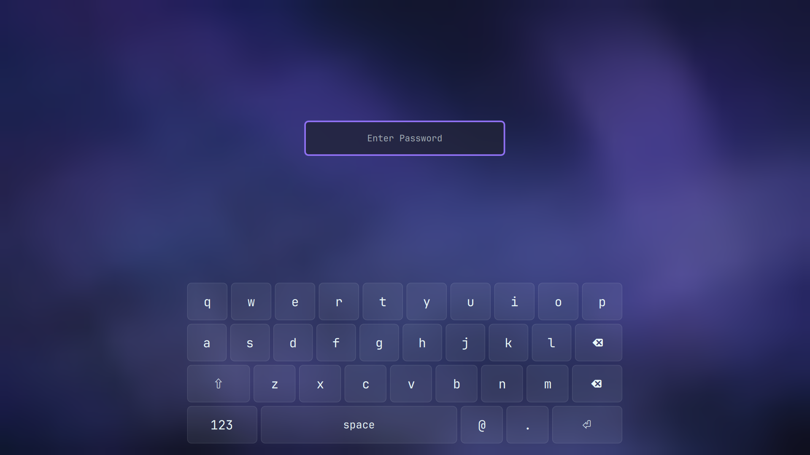

# Tablet Lockscreen Touch

**On-screen keyboard for every lock screen a tablet meets on Omarchy** — the
session lock and the boot/login screen, both typed with your finger, both
shipping in this one repository.

Use a tablet, a handheld, or any machine with no hardware keyboard and the
stock Omarchy locks stop being usable: the password field expects a keyboard
that is not there. Tablet Lockscreen Touch adds a real touch keypad to both
screens where Omarchy asks for a password, and keeps the rest of the stock
experience — masked password dots, PAM authentication, fingerprint support,
and the wallpaper blur — exactly as it was.

| Where | What | Files |
| --- | --- | --- |
| Session lock (`Super` + lock, idle lock, `omarchy-system-lock`) | A Quickshell session lock with a touch keypad, password + fingerprint PAM flows | `Service.qml`, `LockView.qml`, `TouchKeyboard.qml` |
| Boot / login screen | An SDDM greeter theme with its own touch keypad | `sddm-theme/` (`Main.qml`, `Keypad.qml`, artwork) |

The two halves are installed together, updated together and removed together.
There is no second download, no second package, and no network access during
install.



*The plugin's own lock surface: blurred wallpaper, password field and touch keypad, captured with `omarchy-shell lock preview`.*

---

## Session lock

A full Quickshell `WlSessionLock` session lock, cloned from the stock
`omarchy.lock` service so it behaves like the original:

- **Touch keypad, always available.** It is drawn inside the same lock surface
  as the password field, because compositor-level keyboards (Omaqwerty and
  friends) are hidden while the session is locked. Nothing can be typed while
  the screen is locked unless it is on the lock surface itself.
- **Three key pages.** Letters, numbers and symbols share one grid; `123` /
  `#+=` / `ABC` switch pages.
- **Phone-style Shift.** Tap `⇧` for one capital, double-tap to lock it (`⇪`),
  tap once more to release.
- **Backspace that repeats.** Hold `⌫` and it starts deleting after a short
  delay, like a real keyboard.
- **Enter submits.** `⏎` sends the password through the same PAM flow the
  hardware keyboard uses, so failure messages, the attempt counter and the
  masked dots stay stock.
- **Long passwords stay readable.** The dots shrink to fit the field instead of
  clipping, so you can always see that every keystroke landed.
- **Fingerprint when you have it.** If `fprintd` has an enrolled finger and
  `/etc/pam.d/omarchy-lock-fingerprint` exists, the sensor is armed as soon as
  the lock becomes secure and a fingerprint glyph appears inside the field. A
  failed scan re-arms; a good one unlocks.
- **Blurred wallpaper.** The current Omarchy background is blurred with a
  `MultiEffect` and reloaded when you change wallpaper mid-session.
- **Somebody still has to see the screen.** Five seconds after locking, the
  display and keyboard backlight are switched off through
  `omarchy-brightness-*`; any touch wakes them again. A password check in
  flight keeps the panel lit.
- **Multi-monitor.** Every output gets a lock surface, and the layout waits for
  the compositor to report real screens before locking.
- **No orphaned lock screens.** If a lock survived a shell restart (Hyprland's
  failsafe), the service detects it and re-opens its own lock so you are never
  stuck behind a blank session.
- **IPC compatible with the stock lock,** so Omarchy's own scripts keep
  working:

  ```bash
  omarchy-shell lock lock          # lock now
  omarchy-shell lock isLocked      # true / false
  omarchy-shell lock status        # JSON state, for scripts
  omarchy-shell lock preview       # show the lock UI over the desktop
  omarchy-shell lock hidePreview   # hide it again
  ```

---

## Login screen

An SDDM greeter theme (`SddmGreeterTheme`, Qt 6) for the boot screen:

- **Its own keypad,** a plain QML keypad that appends to the password field
  directly. It needs no Qt VirtualKeyboard, no `QT_IM_MODULE`, and no
  input-method plugin, so it cannot break when the greeter's Qt version and the
  virtual-keyboard module disagree.
- **The same three pages and phone-style Shift** as the session lock, so
  learning one keyboard teaches you both.
- **Nothing hides behind the keys.** The logo and password field stay centred in
  the space the keypad leaves free, at any screen size — including portrait
  tablet panels.
- **Stock artwork and colour palette** (Tokyo Night), with the failure state
  swapping the entry frame and lock glyph.
- **Logs into the right session.** The `uwsm` session is preselected; the
  password field accepts up to 128 characters and clears itself after a failed
  attempt.

---

## Why one package instead of one plugin

A single Omarchy plugin cannot cover both screens:

- The SDDM greeter runs as its own user (`sddm`) before any session exists. It
  can only load a theme from `/usr/share/sddm/themes` through `SddmComponents`,
  so it is not a shell plugin at all.
- The session lock lives inside the running Quickshell shell, so it has to be a
  shell plugin directory under `~/.config/omarchy/plugins` — that is the only
  hook the lock service has.

So the split lives inside one repository: `manifest.json` and the QML files are
the lock plugin, `sddm-theme/` is the login theme, and `install.sh` handles
both. Only the lock half is registered in the shell.

---

## Requirements

- Omarchy with the Quattro shell (Quickshell) on Hyprland.
- `python3` (the installer edits `shell.json` safely with it).
- `sudo` for the SDDM half (or run the installer as root).
- Fingerprint unlocking is optional: it needs `fprintd` and an enrolled finger.
- No extra packages. Nothing is downloaded during install.

---

## Install

### From the plugin manager

```bash
omarchy plugin add https://github.com/omiddev9/tablet-lockscreen-touch.git --enable
~/.config/omarchy/plugins/io.github.omiddev9.tablet-lockscreen-touch/install.sh
```

The first command installs and registers the lock plugin. The second installs
the SDDM login theme, which lives outside the plugin folder. Running
`install.sh` from inside the plugin folder is safe: it recognises that the
checkout already *is* the plugin directory and leaves those files alone.

Two lock services cannot share a session, so retire the stock one:

```bash
omarchy plugin disable omarchy.lock
```

### From a release archive

```bash
unzip tablet-lockscreen-touch-1.0.0.zip
cd tablet-lockscreen-touch-1.0.0
./install.sh
```

### What the installer does

1. Copies the theme to `/usr/share/sddm/themes/tablet-lockscreen-touch`
   (any previous copy is backed up as `*.bak-<timestamp>` first) and writes
   `/etc/sddm.conf.d/zz-tablet-lockscreen-touch-theme.conf` selecting it.
2. Copies the lock plugin to
   `~/.config/omarchy/plugins/io.github.omiddev9.tablet-lockscreen-touch`,
   backs up `~/.config/omarchy/shell.json`, and adds
   `{"id": "io.github.omiddev9.tablet-lockscreen-touch"}` to its `plugins`
   list if it is not there yet.
3. Asks the running shell to reload its config and rescan plugins.
4. Prints the exact files it installed.

Applying it:

- **login screen:** `sudo systemctl restart sddm`, or just reboot;
- **session lock:** log out and back in, then lock the session.

### Installer test hooks

To exercise the installer without touching the real system, redirect its paths:

```bash
TABLET_LOCK_TOUCH_THEME_DIR=/tmp/root/usr/share/sddm/themes \
TABLET_LOCK_TOUCH_SDDM_CONF_DIR=/tmp/root/etc/sddm.conf.d \
TABLET_LOCK_TOUCH_NO_ROOT=1 HOME=/tmp/root/home ./install.sh
```

---

## Usage

Lock the session the way you always do — `Super` + lock, the Omarchy menu, or
the idle timeout:

```bash
omarchy-system-lock
```

Then unlock with the keypad: type the password, press `⏎`, or touch the
fingerprint sensor if one is enrolled.

If you want the lock UI on screen without actually locking (for screenshots or
theme work):

```bash
omarchy-shell lock preview
omarchy-shell lock hidePreview
```

---

## Configuration

There is nothing to configure to use it, and the plugin writes no settings of
its own. Things you may want to know:

- **Which PAM stacks are used.** Passwords go through
  `/etc/pam.d/omarchy-lock-password` and fingerprints through
  `/etc/pam.d/omarchy-lock-fingerprint` — the same files the stock lock reads.
  If the password stack is missing, the service refuses to lock and logs
  `lock-denied: missing-pam` instead of locking you out; create the file the
  way Omarchy's stock lock does.
- **Background.** The lock follows `~/.local/state/omarchy/current/background`,
  so it always matches your current wallpaper.
- **Blanking.** Five seconds after locking, the display and keyboard backlight
  are switched off with `omarchy-brightness-display off` and
  `omarchy-brightness-keyboard off`; any touch wakes them.
- **Theme colours.** The SDDM theme ships its own Tokyo Night palette in
  `sddm-theme/Keypad.qml` and `sddm-theme/Main.qml`; the lock keyboard follows
  the shell's `Color.lock` and `Style` values, so it tracks the desktop theme.

---

## Troubleshooting

| Symptom | Cause and fix |
| --- | --- |
| The old lock still appears | Two lock services are enabled. Run `omarchy plugin disable omarchy.lock`. |
| Locking does nothing, log says `missing-pam` | `/etc/pam.d/omarchy-lock-password` does not exist. Recreate the stock lock's PAM file. |
| No fingerprint prompt | `fprintd` missing, no enrolled finger, or no `/etc/pam.d/omarchy-lock-fingerprint`. Password unlock still works. |
| Login screen still the old theme | SDDM has not been restarted: `sudo systemctl restart sddm`. |
| The keypad is missing on a very small window | The lock hides the keypad below 320×180 logical pixels; resize the surface or the display scale. |
| Check the state | `omarchy-shell lock status` prints lock, PAM, fingerprint and screen details. |

---

## Uninstall

```bash
./uninstall.sh
```

Removes both halves and the plugin entry from `shell.json`. `*.bak-*` backups
are kept on purpose. Re-enable the stock lock and leave the theme:

```bash
omarchy plugin enable omarchy.lock
sudo systemctl restart sddm
```

---

## Author

**Omid.Developer** — [github.com/omiddev9](https://github.com/omiddev9)

## License

MIT — see [LICENSE](LICENSE).
